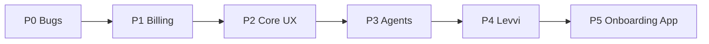

# Catalyst Client Revisions — Implementation Plan (Detailed Sub-Tasks)

**Source:** Catalyst Dev Task List (Oct 7, 2026 · @Anthony)  
**Product principle:** One platform + one agent architecture + different knowledge bases. No industry-specific forks.  
**Target onboarding:** Create Account → Connect Systems → Upload Business Knowledge → Configure Agent → Import Leads → Launch (hours, self-serve).

---

## How to use this plan

| Rule | Meaning |
|------|---------|
| Product vs one-customer | Prefer work that improves Catalyst for all verticals. |
| Config over code | Industry differences live in KB, prompts, templates, settings, rules — not custom screens. |
| Order | **P0 → P1 → P2 → P3 → P4 → P5** (do not skip P0). |
| Checkbox meaning | `[ ]` = not started · `[~]` = in progress · `[x]` = done |

---

## Phase overview

| Phase | Focus | Exit criteria |
|-------|--------|----------------|
| **P0** | Live-testing bugs | Mobile usable; no phantom conversations; proposals status truthful; bell works on iPhone |
| **P1** | Billing & pricing | $297 documented; per-client monthly fee; hybrid usage; pause rules + asterisk |
| **P2** | Core app UX | Dashboard; calendar; lead timeline; proposals; branding; sandbox gated |
| **P3** | Agents & communications | SDR digital-employee console; unified lead inbox; one agent × many KBs |
| **P4** | Levvi | First-login guided setup; voice spike; NL config later |
| **P5** | External onboarding app | Self-serve + staff-assisted handoff |



---

# P0 — Bugs from live testing (fix first)

**Goal:** Make the live product trustworthy on phone and desktop before any redesign work.  
**Owner hint:** Frontend + API tenant scoping.  
**Suggested duration:** 3–5 days.

---

## P0.1 — Mobile viewport after login

**Problem:** After login on phone, the app does not fit the screen; user must zoom out.

### Investigation
- [ ] Reproduce on **iPhone Safari** (375×812 and 390×844) and Android Chrome
- [ ] Note which screen is broken first (dashboard, sidebar, login→home transition)
- [ ] Inspect `index.html` / Vite HTML for `<meta name="viewport" …>`
- [ ] Inspect global CSS: `html`, `body`, `#root`, `min-width`, `overflow-x`
- [ ] Find fixed pixel widths in shell (`App.jsx` sidebar, top bar, content grid)
- [ ] Check if desktop sidebar forces horizontal scroll on mobile
- [ ] Capture before screenshots for Anthony

### Implementation
- [ ] Ensure viewport meta is: `width=device-width, initial-scale=1, viewport-fit=cover` (no max-scale hacks that force zoom)
- [ ] Set `overflow-x: hidden` on root only where safe; prefer shrinking layout over clipping
- [ ] Convert shell to mobile layout:
  - [ ] Collapsible / drawer sidebar under ~768px
  - [ ] Full-width main content
  - [ ] Touch-friendly top bar height
- [ ] Replace hard-coded wide grids with responsive CSS (`minmax`, flex wrap, media queries)
- [ ] Fix any page with `minWidth: 1200` (or similar) used after login
- [ ] Ensure login → first authenticated route does not inherit desktop-only styles

### Verification
- [ ] Fresh login on iPhone: no pinch-zoom needed for nav + first screen
- [ ] Scroll vertically works; no horizontal rubber-band for main chrome
- [ ] Rotate portrait/landscape without broken layout
- [ ] Smoke-test: Leads, Billing, SDR Setup on mobile
- [ ] After screenshots for Anthony

**Done when:** Phone login is usable without zooming out.

---

## P0.2 — Conversation Replay showing phantom data

**Problem:** Fresh login shows conversations that never happened (seed/demo or cross-account leak).

### Investigation (treat as security until proven otherwise)
- [ ] Create a **brand-new test account** (new org) and open Conversation Replay
- [ ] List every row shown: IDs, lead names, timestamps, org/workspace ids
- [ ] Trace UI data source in `App.jsx` (`ConversationReplayPage`, hardcoded demo arrays)
- [ ] Trace API: which endpoint feeds replay / messages / call sessions
- [ ] Check if response includes other orgs’ `organizationId` / `workspaceId`
- [ ] Search codebase for demo seeds: `seed`, `demo`, `fixture`, fake conversation copy
- [ ] Check DB seed scripts (`db:seed`) for conversation/message rows tied to default orgs
- [ ] Confirm whether phantom rows are **UI-only** vs **real DB rows from another tenant**

### Fix — UI demo data
- [ ] Remove hardcoded Conversation Replay demo conversations from production UI
- [ ] Replace with empty state: “No conversations yet”
- [ ] Gate any remaining demo behind `NODE_ENV=development` or internal `demoMode` flag
- [ ] Remove “sample insight” cards that imply real calls happened

### Fix — Tenant isolation (if API leak)
- [ ] Audit list endpoints used by Replay / messages / call history for `requireAuth` + org/workspace scope
- [ ] Add workspace middleware checks on every read path
- [ ] Fix any query missing `eq(organizationId)` / `eq(workspaceId)`
- [ ] Log and alert if a query would return cross-tenant rows (dev assert)

### Tests & verification
- [ ] Unit/integration test: new org → conversation list length `0`
- [ ] Test: Org A cannot fetch Org B conversation/session by id (404/403)
- [ ] Manual: two browsers, two accounts — no shared phantom threads
- [ ] Manual: after one real SMS/call, only that org sees it
- [ ] Document root cause for Anthony (seed vs leak) in PR description

**Done when:** New login shows empty Replay; no cross-account data.

---

## P0.3 — Proposals tab false “uploaded” status

**Problem:** UI says items are uploaded when they are not.

### Investigation
- [ ] Reproduce: open Proposals → white-label / logo / document upload areas
- [ ] Note which control shows “✓ Logo uploaded” / uploaded without a file
- [ ] Trace client state (`whiteLabel.logoUploaded`, local defaults in `ProposalsPage`)
- [ ] Trace API: upload endpoint, get-settings endpoint, storage URL
- [ ] Check if default state is `true` in React `useState`
- [ ] Check if settings API returns stale/true without object in storage
- [ ] Check seed/demo proposal rows marked `uploaded` / `sent` incorrectly

### Implementation
- [ ] Default upload flags to `false` until server confirms a stored asset
- [ ] On settings load: set uploaded only if `logoUrl` (or equivalent) is non-null and reachable
- [ ] On upload success: set true only after 2xx + persisted URL returned
- [ ] On upload failure: show error; keep false
- [ ] On refresh: status matches server (no optimistic forever state)
- [ ] Fix proposal list statuses (draft / sent / accepted) to match DB
- [ ] Remove misleading “uploaded” copy for empty assets

### Verification
- [ ] New org: logo shows “not uploaded”
- [ ] Upload real file → status becomes uploaded and survives refresh
- [ ] Delete/clear logo → status returns to not uploaded
- [ ] No proposal shows “uploaded/sent” without backend confirmation

**Done when:** Upload status matches reality after refresh.

---

## P0.4 — Notification bell not registering taps (iPhone)

**Problem:** Top-right bell does not respond to taps; confirmed on iPhone.

### Investigation
- [ ] Reproduce on physical iPhone Safari
- [ ] Identify bell component in header (`App.jsx` top bar)
- [ ] Check computed size (must be ≥ 44×44 pt hit target)
- [ ] Check z-index stacking: overlays, banners, absolute children covering bell
- [ ] Check parent `pointer-events: none` / child `pointer-events: auto`
- [ ] Check if click handler is on a non-interactive `div`/`span`
- [ ] Check if a transparent element sits above the header on mobile
- [ ] Test Android for same issue (scope)

### Implementation
- [ ] Convert bell to `<button type="button">` with accessible label
- [ ] Expand hit area (padding / min width-height 44px)
- [ ] Raise z-index of header actions above page overlays
- [ ] Ensure dropdown opens on `onClick` (and verify touch does not need double-tap)
- [ ] Prevent header layout from covering bell when sidebar drawer opens
- [ ] Fix any `user-select` / gesture CSS interfering on iOS

### Verification
- [ ] Single tap opens notification panel on iPhone Safari
- [ ] Tap outside closes panel
- [ ] Works on Android Chrome
- [ ] Works on desktop
- [ ] No regression: other header buttons still work

**Done when:** Bell opens reliably with one tap on iPhone.

---

## P0 — Phase exit checklist

- [ ] All four bugs fixed and verified on device
- [ ] Root cause of phantom Replay written for client
- [ ] No new P0 regressions on login / leads / proposals
- [ ] Deployed to staging (or prod) and re-tested

---

# P1 — Billing & pricing

**Goal:** Correct money model: documented retainer, per-client fees, hybrid usage, pause rules, legal asterisk.

---

## P1.1 — Document where $297/mo comes from

- [x] Inventory every `29700` / `$297` in repo (`commercial-pricing.ts`, `pricing.ts`, schema defaults, emails, UI, tests)
- [x] Map code plan keys → marketing names (Ignite / Catalyze / Chain Reaction)
- [x] Write short internal note + comment above `DEFAULT_GLOBAL_MONTHLY_FEE_CENTS`
- [ ] Confirm with Anthony that Starter/Ignite = $297 is intentional
- [x] Remove duplicate “mystery” hardcodes where possible (single source of truth)

**Done when:** Anyone can answer “where is $297?” in one file.

---

## P1.2 — Per-client monthly fee (admin-adjustable)

### Data & API
- [ ] Confirm org/commercial field for monthly fee (`monthlyFeeCents` or equivalent)
- [ ] Admin GET/PATCH endpoint to read/update fee per org
- [ ] Validate min/max and currency (USD cents)
- [ ] Audit log who changed the fee

### Admin UI
- [ ] Setting on workspace/org detail: monthly retainer ($)
- [ ] Show current fee + last updated
- [ ] Save → persists without deploy

### Stripe
- [ ] Define behavior when fee changes (next cycle vs prorate)
- [ ] Update subscription / invoice items accordingly
- [ ] Billing page reads org fee, not global constant

### Verification
- [ ] Client A $297, Client B $497 — both charge correctly in test mode
- [ ] UI copy never hardcodes $297 for all clients

---

## P1.3 — Hybrid billing (monthly + usage)

### Product metering matrix (agree with Anthony)
- [ ] List billable events: appointment booked, call minutes, SMS/email AI, other
- [ ] Assign unit for each (appointment / minute / token / message)
- [ ] Mark which are included in retainer vs extra

### Implementation
- [ ] Persist usage events with org id, type, quantity, cost cents
- [ ] Wire appointment booking → usage/charge path (extend existing)
- [ ] Wire call minutes metering to billing export
- [ ] Optional: token/AI-action ledger if Anthony requires token model
- [ ] Stripe invoice: retainer line + usage lines
- [ ] Client Billing UI: clear breakdown

### Verification
- [ ] Test org accrues usage and sees it on invoice preview
- [ ] Zero-usage month still charges retainer only

---

## P1.4 — Non-payment pause

### Schema
- [ ] Add `billingCadence` (`per_appointment` | `weekly` | `monthly`)
- [ ] Add `paymentPlanApproved` (bool) / `pauseExempt`
- [ ] Add `servicePaused`, `pausedAt`, `pauseReason`

### Logic
- [ ] On Stripe payment_failed / unpaid invoice → pause unless exempt
- [ ] On successful payment → clear pause
- [ ] When paused: block outbound SDR call/SMS/email AI (read-only CRM OK)
- [ ] Banner in app: “Service paused — update payment”
- [ ] Admin can approve weekly/monthly plan → skip auto-pause

### Verification
- [ ] Failed payment pauses per-appointment client
- [ ] Approved monthly client is not auto-paused
- [ ] Resume after payment works

---

## P1.5 — Pricing asterisk / legal copy

- [ ] Add `*` after “per appointment” on Billing + public pricing surfaces
- [ ] Place footnote exactly as Anthony specified (weekly/monthly at Leviosa Labs discretion)
- [ ] Include on checkout / invoice PDF / email templates if those say “per appointment”
- [ ] Review with Anthony for final wording

---

## P1 — Phase exit checklist

- [x] $297 documented and mapped to plans
- [x] Admin can set monthly fee per client
- [x] Hybrid retainer + usage path exists (even if some meters TBD)
- [x] Pause rules live with exemption flag
- [x] Asterisk copy live on pricing UI

*(Anthony still needs to confirm Ignite = $297 and final footnote wording.)*

---

# P2 — Core app changes

**Goal:** One Catalyst UX for all industries: dashboard, calendar, lead truth, simpler proposals, branding, no live sandbox.

---

## P2.1 — Dashboard redesign

- [ ] Define standard widgets: performance KPIs, activity, appointments, pipeline health
- [ ] Remove industry-specific dashboard blocks
- [ ] Remove **TCPA Compliant** badge from main chrome (`App.jsx` header/cards)
- [ ] Keep TCPA only in agent rules / KB / backend compliance gates
- [ ] Empty states for new accounts (no fake charts)
- [ ] Responsive layout (reuse P0 mobile shell)
- [ ] Wire widgets to real APIs (leads, appointments, enrollments, calls)

**Done when:** One dashboard works for solar/HVAC/roofing without code forks.

---

## P2.2 — Booking & calendar (replace Booking Ledger)

### Calendar shell
- [ ] Add Day / Week / Month views (large primary surface)
- [ ] Retire or demote Booking Ledger list as primary UX
- [ ] Day drill-down: appointments + availability + details panel

### Availability
- [ ] Edit availability from calendar UI
- [ ] Persist to existing calendar/booking rules APIs
- [ ] Show busy vs open slots clearly

### Appointment management
- [ ] View / update appointment in place
- [ ] Reassign owner/rep
- [ ] Move/reschedule via drag or edit modal
- [ ] Sync with Google Calendar connection where configured

### Kanban
- [ ] Add board view for appointment stages (where it fits)
- [ ] Same data as calendar (no second source of truth)

### Verification
- [ ] Create, move, reassign appointment end-to-end
- [ ] Mobile calendar usable (read + basic edit)

---

## P2.3 — Leads: Conversation Replay → lead timeline

- [ ] Remove standalone **Conversation Replay** nav item (or redirect)
- [ ] Build **one timeline** on lead detail: AI chats, SMS, email, calls, appointments, status changes, AI actions
- [ ] Chronological sort; filters by channel
- [ ] Empty state for leads with no activity
- [ ] Deep-link from notifications/inbox → lead timeline entry
- [ ] Migrate any Replay-only UI affordances into lead page
- [ ] Regression: no phantom timeline items (P0.2)

**Done when:** Lead record is the single source of truth for history.

---

## P2.4 — Proposals simplify

- [ ] Remove financing options not broadly needed
- [ ] Convert free-text where possible → dropdowns (services, packages, configs)
- [ ] Cut unused fields from create form
- [ ] Speed create-and-send (fewer steps, sensible defaults from KB/templates)
- [ ] Industry differences via templates/fields/KB — not separate builders
- [ ] Keep upload status truthful (P0.3)

---

## P2.5 — Platform configuration

- [ ] Remove white-label settings box from live customer settings/proposals
- [ ] Keep minimal branding only (e.g. company name / logo if product still needs it)
- [ ] Hide **Sandbox** from live customer nav/roles
- [ ] Feature-flag sandbox for internal / demo / select enterprise
- [ ] Ensure sandbox routes 403 for normal customers

---

## P2.6 — Catalyst branding

- [ ] Confirm brand kit (logos, colors, fonts, icons) — request re-send if missing
- [ ] Apply tokens in theme (`COLORS`, typography, CSS variables)
- [ ] Replace logos in header, login, emails, favicon
- [ ] Sweep copy for inconsistent product naming
- [ ] Visual QA desktop + mobile

---

## P2 — Phase exit checklist

- [x] New dashboard live; TCPA badge gone from chrome
- [x] Calendar is primary booking UX (day/week/month + list)
- [x] Lead timeline replaces standalone Replay
- [x] Proposals simplified
- [x] Sandbox gated; branding applied (theme tokens already in place — full brand kit assets TBD)

*(P2.6 full logo/favicon kit still awaiting brand assets if not already shipped.)*

---

# P3 — Agents, communications & Levvi surfaces

**Goal:** SDR feels like a manageable digital employee; communications are lead-centered; still one agent architecture.

---

## P3.1 — Rebuild SDR Agent view

- [ ] Design console sections:
  - [ ] Leads currently being worked
  - [ ] Conversations needing human
  - [ ] Appointments generated
  - [ ] Planned next actions
  - [ ] Performance metrics
- [ ] Wire to enrollments, messages, bookings, call sessions APIs
- [ ] Actions: pause lead, take over conversation, open lead timeline
- [ ] Empty states for new workspaces
- [ ] Enforce **one agent build** — no per-industry SDR screens

---

## P3.2 — One agent × many knowledge bases

- [ ] Document config surfaces: KB, system prompt, qualification criteria, business rules, compliance
- [ ] Ensure vertical differences only change those configs
- [ ] Remove any industry-specific agent routes/components if present
- [ ] QA: solar vs HVAC workspace = same UI, different KB content

---

## P3.3 — Unified lead-centered communications

- [ ] Inventory current SMS inbox + email inbox UIs
- [ ] Design unified view (or lead-first inbox that opens timeline)
- [ ] Merge channels: SMS, email, voice, AI, human, appointments, internal actions
- [ ] Decide whether a dedicated ops inbox remains (only if clear need)
- [ ] Migrate users: redirects from old inbox routes
- [ ] Notifications deep-link into unified/lead view

---

## P3 — Phase exit checklist

- [x] SDR console usable as daily operator screen
- [x] No separate industry agent UIs
- [x] Comms centered on lead (old inboxes retired or secondary)

---

# P4 — Levvi onboarding

**Goal:** First login guides setup in hours; optional voice; NL config later.

---

## P4.1 — Levvi on first login

- [x] Detect first login / incomplete onboarding flag
- [x] Launch Levvi wizard steps:
  1. Welcome  
  2. Explain Catalyst  
  3. Business info  
  4. Availability  
  5. Connect channels (phone/email/calendar)  
  6. Import leads  
  7. Configure SDR Agent  
  8. Build / upload knowledge base  
- [x] Persist step progress; allow resume
- [x] Skip completed steps on return
- [x] Align with target funnel: Account → Systems → KB → Agent → Leads → Launch

---

## P4.2 — Voice interaction spike

- [x] Spike: voice I/O for Levvi during onboarding (browser mic + STT/TTS or Realtime)
- [x] Document feasibility, cost, UX risks
- [~] Decision gate with Anthony: ship voice onboarding or defer *(recommend defer — see `Leviosai/docs/P4_VOICE_SPIKE.md`)*

---

## P4.3 — Longer-term NL config (backlog)

- [x] Spec: “Add AC replacement as a service…” → KB/config mutations
- [x] Safety: confirm before write; audit log
- [x] Not required for P4 exit *(parked in `Leviosai/docs/P4_NL_CONFIG_BACKLOG.md`)*

---

## P4 — Phase exit checklist

- [x] First-login Levvi guides full setup path
- [x] Voice spike documented / decided
- [x] NL config parked with clear backlog ticket

---

# P5 — External onboarding app integration

**Goal:** Connect Anthony’s separate onboarding app for self-serve and staff-assisted paths.

---

## P5.1 — Discovery

- [x] Review onboarding app (auth, data model, steps) *(app not in-repo — contract assumes intake app → Catalyst)*
- [x] Map which fields each system owns *(see `Leviosai/docs/P5_ONBOARDING_APP_INTEGRATION.md`)*
- [x] Agree shared `organizationId` / `workspaceId`
- [x] Security review: tokens, CORS, PII *(API key + single-use handoff JWT; documented)*

---

## P5.2 — Integration design

- [x] API: create/link org + workspace from onboarding app
- [x] Handoff: short-lived JWT / one-time code → Catalyst session
- [x] Webhooks: `onboarding.completed` ↔ `sdr.activated`
- [x] Idempotent writes (no duplicate orgs) *(email-based)*

---

## P5.3 — Two paths

### Self-serve client
- [x] Client finishes onboarding app → lands in Catalyst mid/post Levvi *(via `/?handoff=`)*
- [x] Prefill business info / channels where possible *(business/availability draft; channels still optional in Levvi)*

### Staff-assisted
- [x] Internal “onboard on behalf” creates org, connects systems, invites client *(provision `path: staff_assisted` + invite email + handoff URL)*
- [x] Client receives invite and continues with limited remaining steps *(prefill + step hint)*

---

## P5.4 — Verification

- [x] End-to-end self-serve happy path *(unit + route wiring tests; staging E2E needs Anthony’s app)*
- [x] End-to-end staff-assisted happy path *(same — Catalyst side ready)*
- [x] Failure cases: expired handoff, duplicate email, partial setup *(covered in helpers + docs)*

---

## P5 — Phase exit checklist

- [~] Written integration contract approved by Anthony *(draft ready — awaiting sign-off)*
- [ ] Both paths working in staging *(needs shared staging + API key)*
- [x] Runbook for ops team *(`Leviosai/docs/P5_OPS_RUNBOOK.md`)*

---

# Cross-cutting / answers for Anthony (track in parallel)

- [ ] Reply: $297 origin + plan name mapping  
- [ ] Reply: per-appointment rates configurability today vs after P1.2  
- [ ] Reply: billable AI actions matrix (draft in P1.3)  
- [ ] Reply: weekly/monthly plan flag design (P1.4)  
- [ ] Reply: Conversation Replay root cause after P0.2  
- [ ] Reply: branding assets status  
- [x] Reply: onboarding app integration recommendation (P5) *(contract + runbook in `Leviosai/docs/P5_*`)*

---

# Suggested order inside each phase

| Phase | Do first | Then | Last |
|-------|----------|------|------|
| P0 | Replay tenant audit (security) | Mobile + bell | Proposals status |
| P1 | Document $297 + admin fee | Asterisk copy | Pause + hybrid meters |
| P2 | Dashboard + remove TCPA badge | Lead timeline | Calendar rewrite |
| P3 | SDR console | Unified inbox | Polish |
| P4 | First-login wizard | Voice spike | NL backlog |
| P5 | Review their app | Handoff API | Dual-path QA |

---

---

## Automated test coverage (P0–P5)

Run the full Catalyst plan suite from `Leviosai/`:

```bash
npm run test:catalyst
```

Includes: `p0`–`p5` phase tests, `m5` onboarding, `catalyst-plan-coverage` (phase-exit matrix), plus `commercial-pricing`, `subscription-billing`, and `pricing`.

*Device / staging / Anthony sign-off remain manual (see phase exit notes).*

---

*Update checkboxes as work completes. Keep Anthony’s principle: one Catalyst, many knowledge bases.*
